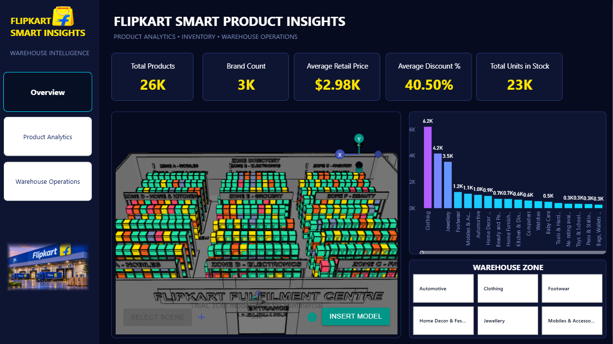

# Smart Insights: 3D Warehouse Analytics (Power BI + 3DBI + SketchUp)

An interactive, three-page Power BI dashboard that links a **3D model of a fulfilment centre** to **product data**. Click a bin in the 3D view and see its SKU, quantity, status and value. Use the product pages to explore pricing, brands and ratings.

> **Disclaimer:** This is an independent portfolio project built for learning. It is not affiliated with, endorsed by or connected to Flipkart. The product data comes from a public Kaggle dataset, and the warehouse bin data is **simulated** (see "About the data").

**Dataset:** [Flipkart Products on Kaggle (PromptCloud)](https://www.kaggle.com/datasets/PromptCloudHQ/flipkart-products)



---

## What it does

| Page | What you can do |
|---|---|
| **Overview** | See the whole warehouse in 3D, with every bin coloured by status. Filter by category and read headline KPIs (products, brands, average price, discount %, units in stock). |
| **Product Analytics** | Explore category share, brand ranking, discount levels, average rating, and retail vs discounted price. |
| **Warehouse Operations** | Check stock by zone and rack, stock quantity by zone, stock distribution by category, and inventory age by velocity class. |


---

## How it works

```
Kaggle product data ──► build_flipkart_dataset.py ──► Flipkart_Warehouse_Bins_REAL_SKUS.csv
                                                          │  (Bin_ID = A-R01-B01-L1 ...)
Flipkart_Warehouse_Builder_v3.rb ──► SketchUp model ──► model.3dbi ──► 3DBI visual in Power BI
  every bin is a component named exactly like Bin_ID        matches Bin_ID <-> bin name
```

1. **Data:** A Python script builds a 1,200-row bin table from real products.
2. **3D model:** A Ruby script builds the warehouse in SketchUp. It has 1,200 bin components, each named with its `Bin_ID`, such as `A-R01-B01-L1` (zone, rack, bay, level).
3. **Link:** The 3DBI visual in Power BI uses `Bin_ID` as the **Object Identifier**, so each row of data paints the matching bin in the model. `Bin_Status` drives the colour.

### The 3D warehouse (built by `Flipkart_Warehouse_Builder_v3.rb`)

- **Layout:** 6 zones x 4 racks x 10 bays x 5 levels = **1,200 pallet bins**.
- **Racking:** white uprights and beams, with a wooden pallet under every bin.
- **Building:** semi-transparent outer walls, an entrance gap with a front-wall sign, and a back-wall zone directory.
- **Zone names:** each zone has a coloured floor patch, a name painted on the floor, and an overhead banner on posts.
- **Loading docks:** 8 numbered dock doors (DOCK 1 to 8) on the right-hand wall, each with a roll-up door, a dock leveller and a truck with trailer parked at it, plus a paved yard.

| Zone | Name on the 3D signs |
|---|---|
| A | Mobiles |
| B | Electronics |
| C | Fashion |
| D | Home & Kitchen |
| E | Grocery |
| F | Beauty |

### Bin status colours

| Status | Colour |
|---|---|
| Optimal | Mint green |
| Low Stock | Amber |
| Overstock | Orange |
| Blocked | Hot pink-red |
| Empty | Slate |

---

## About the data

- **Products (real):** The public Kaggle dataset **[Flipkart Products](https://www.kaggle.com/datasets/PromptCloudHQ/flipkart-products)** by PromptCloud (`flipkart_com-ecommerce_sample.csv`, about 20,000 products, 15 columns). It has names, categories, brands, retail and discounted prices, and ratings.
  The file is **not included** in this repo. Download it from the link above, check the licence on the Kaggle page, and put the CSV in the same folder as the script.
- **Warehouse bins (simulated):** `Flipkart_Warehouse_Bins_REAL_SKUS.csv` assigns real products to bins, but the **quantities, bin status, velocity class, days in storage and inbound dates are randomly generated** (fixed seed `7`) to simulate a warehouse. The insights in this project are therefore **illustrative, not real operations data**.
- **Zone names:** The 3D signs use department names (table above). In the data table, the `Zone_Name` column holds the product category assigned to each zone letter. Power BI links the data to the model by `Bin_ID`, not by name.
- **Data quality note:** About 91% of products in the source file (18,151 of 20,000) have **no rating**, so the average rating gauge is based on the small rated subset.

### Bin table columns (19)

`Bin_ID, Zone, Zone_Name, Rack, Bay, Level, SKU, Product_Name, Brand, Category, Qty, Bin_Capacity, Fill_Pct, Bin_Status, Unit_Price_INR, Stock_Value_INR, Velocity_Class, Days_In_Storage, Inbound_Date`

---

## Headline numbers (from the simulated bin data)

| Metric | Value |
|---|---|
| Total bins | 1,200 |
| Total units in stock | 23,474 |
| Stock value | ₹4.68 crore (₹46,818,057) |
| Occupied bins | 93% (1,116 of 1,200) |
| Average bin fill | 48.9% |
| Bins: Optimal / Low Stock / Overstock / Empty / Blocked | 739 / 193 / 131 / 84 / 53 |
| Velocity class: A-Fast / B-Medium / C-Slow | 258 / 452 / 406 |
| Stock older than 90 days | ₹1.32 crore (28% of stock value) |

**Example observations** (illustrative, because the data is simulated):
- About 1 in 6 bins is **Low Stock**, which is far more than the share that is **Blocked** (4.4%).
- Over a quarter of the stock value has been in storage **more than 90 days**, so it is a candidate for clearance.

---

## Example DAX measures

```DAX
Total Products        = DISTINCTCOUNT(Flipkart_Products[unq_id])
Total Bins            = DISTINCTCOUNT(Flipkart_Warehouse[Bin_ID])
Average Bin Fill %    = AVERAGE(Flipkart_Warehouse[Fill_Pct])
Average Days in Stock = AVERAGE(Flipkart_Warehouse[Days_In_Storage])
Total Inventory Value = SUM(Flipkart_Warehouse[Stock_Value_INR])
```

---

## Repository contents

```
.
├── README.md
├── Flipkart_Smart_Product_Insights.pbix        Power BI report (3 pages, 3DBI visual embedded)
├── Flipkart_Warehouse_Bins_REAL_SKUS.csv       1,200-bin warehouse table
├── build_flipkart_dataset.py                   Builds the bin table from the Kaggle file
├── Flipkart_Warehouse_Builder_v3.rb            Builds the 3D warehouse (with docks) in SketchUp
├── Flipkart_FC.skp                             The 3D warehouse model
├── model.3dbi                                  Model package used by the 3DBI visual
├── Overview.png                                Dashboard page 1
├── Product_Analytics.png                       Dashboard page 2
└── Warehouse_Operations.png                    Dashboard page 3
```

---

## How to run it

### Just look at the dashboard
1. Install **Power BI Desktop** (free, Windows).
2. Open `Flipkart_Smart_Product_Insights.pbix`.
3. The 3D visual is the **3DBI** custom visual. It runs in trial mode and shows a "TRIAL 3DBI model, not for commercial use" banner.

### Rebuild the data
```bash
pip install pandas numpy
# 1. Download flipkart_com-ecommerce_sample.csv from
#    https://www.kaggle.com/datasets/PromptCloudHQ/flipkart-products
#    and save it in the same folder as the script
python build_flipkart_dataset.py
```
This writes `Flipkart_Warehouse_Bins_REAL_SKUS.csv`. The product pick is seeded, but the inbound dates are calculated from today's date, so they shift each time you run it.

### Rebuild the 3D model
1. Open SketchUp, then **Window > Ruby Console**.
2. Paste the contents of `Flipkart_Warehouse_Builder_v3.rb` and press Enter.
3. The build is a single undo step (Ctrl+Z). The script names every bin component `Zone-Rack-Bay-Level`, which must match `Bin_ID` exactly, so **do not rename or move bins**.
4. Save as `.skp` and upload it in the 3DBI visual using **INSERT MODEL**.

Layout, colours, zone names and dock count can be changed in the settings block at the top of the script.

---

## Tools used

- **Power BI Desktop**: modelling, DAX, report design, page navigation
- **3DBI** (Power BI custom visual): 3D model linked to data
- **SketchUp** with the **Ruby API**: scripted 3D warehouse (racks, pallets, walls, zone signs, loading docks and trucks)
- **Python** (pandas, numpy): dataset generation
- **Power Query**: cleaning product categories (removing list brackets, extracting the top-level category)

---

## Limitations

- Warehouse bin quantities, statuses and ages are **simulated**, not real operating data.
- 3DBI is used in **trial mode**, which is not for commercial use.
- The product file has many missing ratings (see above), which affects rating-based visuals.
- The 3D signs use department names, while the data holds product categories per zone (see "About the data").

---

## What I learned

- Linking a 3D model to a data table through a shared ID, and why the naming must be exact.
- Cleaning messy nested category text in Power Query.
- Scripting repeatable 3D geometry with the SketchUp Ruby API.
- Designing a consistent dark dashboard theme with navigation and a status colour system.

---

## Data source and credits

- Product data: [Flipkart Products](https://www.kaggle.com/datasets/PromptCloudHQ/flipkart-products) on Kaggle, by PromptCloud. All rights remain with the original authors.
- 3D visual: [3DBI](https://3dbi.com) custom visual for Power BI.
- Flipkart is a trademark of its owner. This project is not affiliated with it.

---

## Author

**Harshitha Guntha**
[LinkedIn](https://www.linkedin.com/in/harshitha-guntha-4761932b2)
